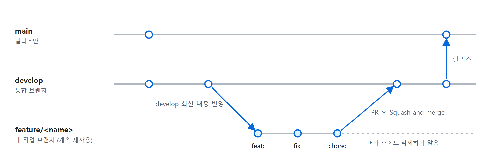

# 브랜치 전략

출처: GitHub 협업 가이드 "7. 브랜치와 커밋" (2026-11-18 반영). aibms 레포 3개(frontend · backend · aiagent)가 같은 규칙을 쓴다.

## 브랜치



| 브랜치 | 용도 |
|---|---|
| `main` | 릴리스만 |
| `develop` | 통합 브랜치 |
| `feature/<name>` | 내 작업 브랜치 (계속 재사용) |

- 각자 `feature/<name>` 브랜치 하나만 만들어 계속 사용합니다. 예: `feature/namju`
- `main`과 `develop`에는 직접 커밋하지 않습니다.
- `fix/`, `chore/` 같은 다른 브랜치는 만들지 않습니다. 변경 종류는 커밋 타입으로 구분합니다.
- 작업을 시작하기 전에 `develop` 최신 내용을 내 브랜치에 반영합니다.

```bash
git fetch --prune
git checkout feature/<name>
git merge origin/develop
```

## 커밋 메시지

```
<type>: <summary> (#issue)
```

`(#issue)`는 관련 Issue가 있을 때만 적습니다.

| 타입 | 의미 |
|---|---|
| feat | 새로운 기능 추가 |
| fix | 버그 수정 |
| docs | 문서 수정 |
| test | 테스트 코드 추가 |
| refact | 코드 리팩토링 |
| style | 코드 의미에 영향을 주지 않는 변경 (공백, 들여쓰기 등) |
| chore | 빌드, 패키지 매니저, 설정 수정 |

예:

```
feat: Add PO multi-row editor to outsource screen (#42)
fix: Update budget total after PO row delete (#88)
chore: Add ESLint config
```

## Pull Request

1. `feature/<name>`에서 `develop`으로 PR을 만듭니다.
2. PR 템플릿을 작성합니다. UI가 바뀐 경우 스크린샷을 첨부합니다.
3. 본문에 `Related to #42`를 적어 Issue와 연결합니다. (`Closes`는 쓰지 않습니다. QA 통과 후 QA 담당자가 Issue를 Close합니다.)
4. 리뷰어를 지정합니다. 리뷰어는 코드를 확인하고 승인합니다.
5. 승인 후 **Squash and merge**로 반영합니다.
6. `feature/<name>` 브랜치는 삭제하지 않고 계속 사용합니다.

## 저장소 설정 (관리자)

- `main`, `develop` 브랜치 보호 (PR 필수, 직접 push 금지)
- 기본 브랜치(Default branch)는 `develop` — PR 화면의 base 가 기본 브랜치로 잡힌다
- Squash and merge 를 허용한다 (Settings → General → Pull Requests)

## 배포 연동 (현재 CI 기준)

| 이벤트 | CI 동작 (`.github/workflows`) |
|---|---|
| `feature/<name>` → `develop` PR | 빌드·테스트 |
| `develop` 에 머지 | 빌드 → dev 배포 (현재 시뮬레이션) |
| `develop` → `main` 릴리스 후 `main` 커밋에 `v<버전>` 태그 | 빌드 → prod 배포 (현재 시뮬레이션, Environment 승인) |

- `main` 으로 오는 PR 은 `pr-base-guard` 가 출발 브랜치를 검사한다 (`develop` 허용)
- 워크플로에는 이전 전략의 `release/*`(stag)·`hotfix/*` 조건이 남아 있다. 이 전략에서는 쓰지 않는다
